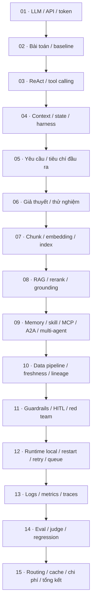
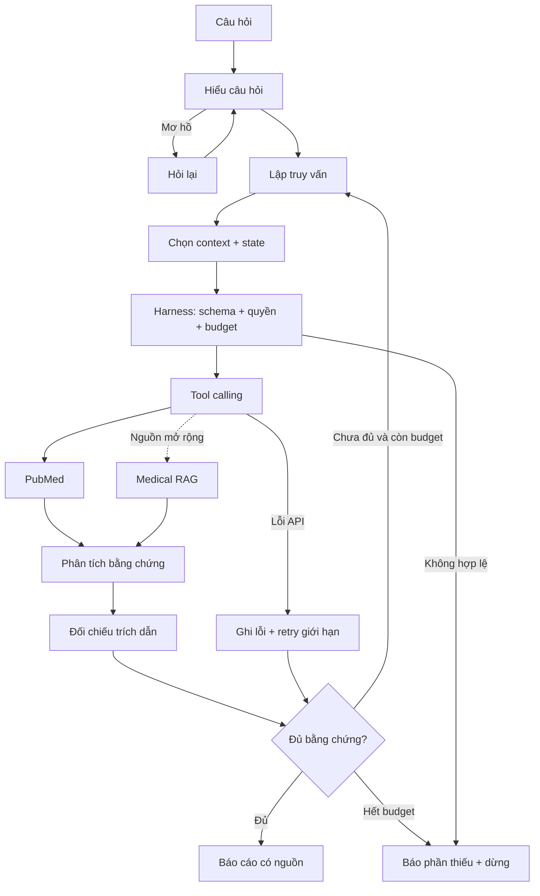
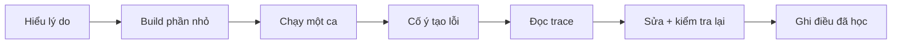

# Pipeline học theo 15 phần PDF

Nguồn: [Agent-Vin.pdf](../../Agent-Vin.pdf). Mỗi Day là một chương, không phải hạn một ngày.
Các sơ đồ là thiết kế để học; chưa phải các tính năng đã triển khai.

**Ứng dụng hiện tại:** `python3 -m medical_agent`. Xem [sơ đồ bản local v1 và cách đọc code](system.md).

## 1. Bản đồ học

Eval, log và giới hạn có từ bản đầu; các chương sau đào sâu và so sánh.
MCP, A2A và nhiều worker là bài thực nghiệm; chỉ giữ khi có ích.

## 2. Một lượt chạy agent

## 3. Vòng học mỗi tính năng

**Các ca mô phỏng:** Alzheimer hoàn tất · COPD hỏi lại · ung thư phổi tìm bổ sung · PubMed timeout · tài liệu chứa injection.

**Đang học:** chạy [hệ thống tích hợp](system.md), quan sát quyết định và đọc trace.
Các bài nhỏ, gồm [vòng lặp hai tool](7.md), được giữ để học từng thành phần.
**Chi tiết trách nhiệm và nguồn:** [workflow.md](workflow.md).
