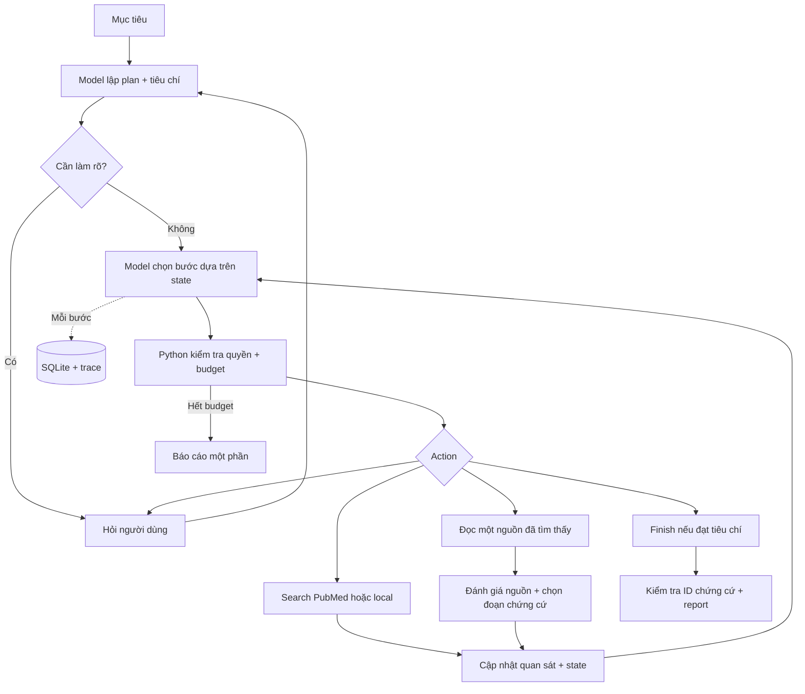

# Hệ thống agent local v2

Bản v2 bổ sung bảng nghiên cứu theo span ID, liên kết claim–evidence, lưu query
translation, question spec, baseline fixed, runner A/B, manifest, metrics,
backup/restore/rebuild và đóng gói nguồn. Xem [kết quả thực tế](implementation-status.md)
và [runbook](runbook.md). Các phần dưới mô tả cơ chế cốt lõi kế thừa từ v1.

**Giao diện HTML đã có:** `python3 -m medical_agent.web --port 8001`.
Frontend dùng chung engine/store với CLI, chạy tác vụ nghiên cứu trong một thread
riêng và đọc tiến độ qua API local. Xem [frontend.md](frontend.md) để smoke test.

Chạy: `python3 -m medical_agent`. Các phần nâng cao trong [pipeline PDF](learning-pipeline.md)
được giữ làm lộ trình học, không coi là đã triển khai.



## Đọc code theo một lượt chạy

| Thứ tự | Chỗ đọc | Điều cần hiểu |
|---|---|---|
| 1 | `cli.py:main` | Nhận input |
| 2 | `engine.py:start`, `_plan` | Mục tiêu thành tiêu chí |
| 3 | `_packet`, `_decision` | Context nào giúp chọn bước tiếp |
| 4 | `_validate_action`, `_execute_pending` | Python kiểm tra và thực thi tool |
| 5 | `_assess` | Giữ hoặc loại nguồn |
| 6 | `report.py:readiness` | Điều kiện được hoàn tất |
| 7 | `_finish`, `validate_claims` | Tổng hợp có ID chứng cứ |
| 8 | `store.py:checkpoint`, `resume` | Tắt rồi chạy tiếp |

```text
Mục tiêu → search → đọc A → A không phù hợp
        → đổi truy vấn → đọc B → đủ chứng cứ → report
```

Model chọn bước theo kết quả quan sát; không có nhánh hardcode cho từng bệnh.
Ca đổi truy vấn sau khi loại nguồn được test bằng model giả lập. Ca Ollama thật đã
chạy với một snapshot PubMed; chưa xác nhận trọn luồng online ổn định.

Bản tích hợp dùng **structured decision JSON + runtime dispatch**, khác giao thức
native `message.tool_calls` trong bài 3. Cả hai đều cần Python thực thi tool.
Schema không bảo đảm nội dung đúng; runtime vẫn kiểm tra action, ID, truy vấn lặp, budget.

## Memory và vận hành

| Nơi lưu | Nội dung |
|---|---|
| State của run | Goal, plan, ứng viên, nguồn, chứng cứ, pending action, budget |
| SQLite | Checkpoint, corpus local, lịch sử các run |
| Cache | Response PubMed, TTL 24 giờ khi online |
| Context model | Plan, ứng viên chưa đọc, đánh giá, các quan sát gần nhất |

Không đưa toàn bộ lịch sử vào model. Giới hạn context kiểm tra bảo thủ theo byte,
không phải tokenizer chính xác; quá lớn thì báo lỗi, không âm thầm cắt chứng cứ.
Tool chỉ tìm/đọc nguồn; không cho model gọi shell hoặc mở URL tùy ý.
Tài liệu được đánh dấu untrusted; chưa có red-team prompt injection toàn diện.

Lưu `pending_action` trước tool call; resume có thể thực hiện lại thao tác đọc bị
ngắt. Giữ nguyên budget, không tính thời gian người dùng nghỉ vào thời gian chủ động.

## Nguồn và chứng cứ

| Action | Điều kiện |
|---|---|
| `search_pubmed` | Online, chưa bị chặn, còn budget |
| `search_local` | Có corpus chưa đọc, còn budget |
| `read_source` | ID đã xuất hiện trong kết quả tìm kiếm, chưa đọc |
| `ask_user` | Chưa đủ phạm vi hoặc chứng cứ |
| `finish` | Đủ số tài liệu gốc và tiêu chí có đoạn chứng cứ |

Code kiểm tra năm; thiếu abstract hoặc không xác nhận được năm trong phạm vi thì
loại nguồn. Model chọn **ID đoạn**, code lấy nguyên văn. Report chỉ nhận ID chứng
cứ đã có, so sánh cần hai tài liệu gốc. Truy vết được không đồng nghĩa kết luận đúng:
độ liên quan, độ bao phủ và suy luận vẫn cần người đọc kiểm tra.

Ingest nhận txt/md/json/jsonl ≤10 MB mỗi file; JSON bài 4 giữ PMID/DOI/ngày lấy nguồn.
Local chunk 2.600 ký tự, overlap 200; tìm bằng SQLite FTS5/BM25, chưa có embedding/reranker.
Nạp lại file đã cập nhật sẽ thay các chunk cũ.

NCBI lỗi khác kết quả rỗng. Tối đa một retry cho lỗi tạm thời; gặp trang chặn thì
ngừng gọi PubMed, dùng corpus nếu có. Offline không tra cứu NCBI, vẫn gọi Ollama localhost.

## Kiểm tra và review

```bash
python3 -m medical_agent runs
python3 -m medical_agent trace RUN_ID
python3 -m medical_agent eval RUN_ID
python3 -m medical_agent review RUN_ID rejected
```

| Trạng thái | Ý nghĩa |
|---|---|
| `waiting_for_user` | Chờ bổ sung, resume cùng run |
| `paused_source` | Nguồn chặn, chưa có corpus thay thế |
| `interrupted` | Ctrl+C, đã lưu checkpoint |
| `completed` | Đạt hợp đồng cấu trúc; chưa đồng nghĩa đúng y khoa |
| `partial` | Thiếu bằng chứng, hết budget hoặc report chưa đạt |
| `failed` | Lỗi trước khi có kết quả dùng được |
| `out_of_scope` | Yêu cầu chẩn đoán/kê đơn cá nhân đã được nhận diện; không gọi tool |

Tests kiểm tra loại nguồn/đổi truy vấn, năm, chứng cứ giả, ID lạ, lặp truy vấn,
nguồn chặn/chuyển local, hỏi lại, restart và budget. Fixtures là dữ liệu tổng hợp,
không phải benchmark y khoa. `eval` chấm cấu trúc; review được lưu riêng với kết quả máy.

**Chưa triển khai:** dense RAG/rerank, MCP, A2A, multi-agent, hàng đợi bền vững/nhiều
worker, cloud deployment, clinical eval. App HTML hiện chạy một phiên nghiên cứu
tại một thời điểm trên localhost.

Tham khảo: [Ollama structured outputs](https://docs.ollama.com/capabilities/structured-outputs),
[SQLite FTS5](https://www.sqlite.org/fts5.html),
[NCBI usage guidelines](https://eutilities.github.io/site/API_Key/usageandkey/).
