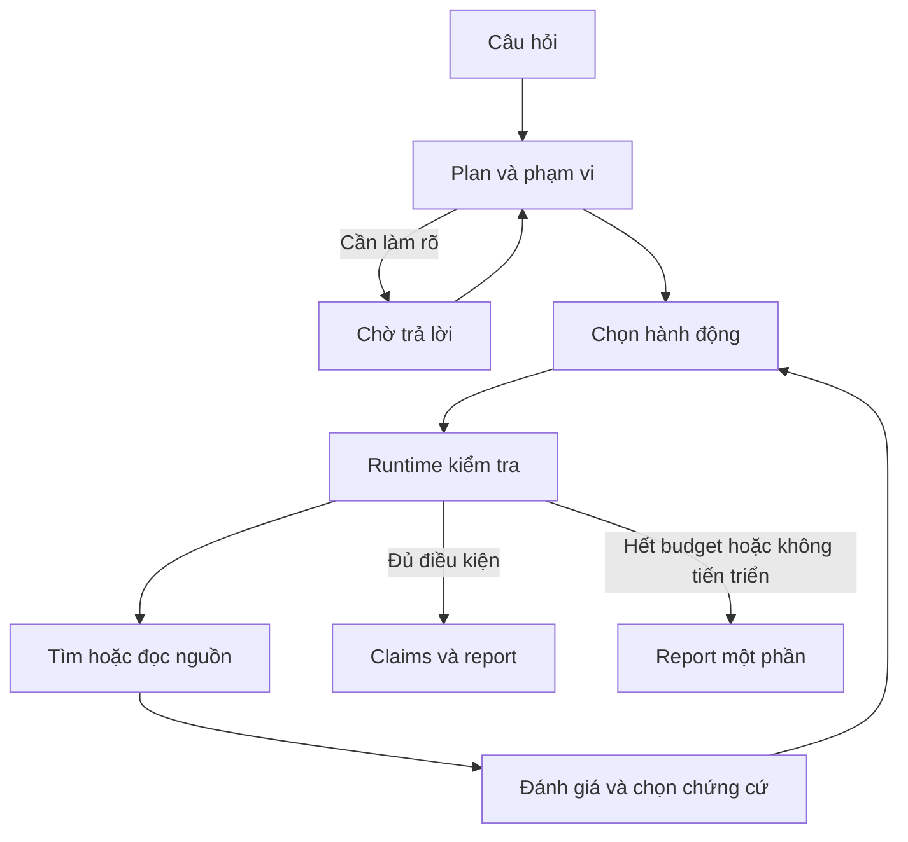

# Báo cáo kỹ thuật Biomedical Research Agent

**Bản thảo triển khai ngày 28/10/2026.** Tài liệu mô tả hệ thống và những kết quả
đã quan sát, phục vụ biên soạn báo cáo đồ án theo mẫu trường. Chưa phải bản nghiệm
thu cuối, chưa có tên tác giả/giảng viên, tổng quan học thuật đầy đủ hoặc benchmark
nội dung đã được chấm độc lập.

## 1. Bài toán và mục tiêu

Người học nghiên cứu y sinh cần tìm tài liệu, xác định phần liên quan, đối chiếu
phát hiện và trình bày nhận định có nguồn. Quá trình này yêu cầu giữ được mối liên
hệ từ nhận định đến đoạn tài liệu đã đọc, đồng thời phân biệt thiếu dữ liệu với
lỗi truy cập nguồn. Hệ thống hỗ trợ công việc đó thông qua một agent chạy cục bộ.

Đầu vào là câu hỏi nghiên cứu tiếng Việt có thể kèm quần thể, can thiệp/phơi nhiễm,
kết cục và khoảng năm. Đầu ra là phạm vi áp dụng, nhật ký tìm kiếm, bảng nghiên cứu,
nhận định có evidence IDs, nguồn, giới hạn và trạng thái review. Hệ thống không
chẩn đoán hoặc kê đơn cho bệnh nhân cụ thể.

Ba tình huống gốc là giấc ngủ–Alzheimer, CT liều thấp–sàng lọc ung thư phổi và
phục hồi chức năng hô hấp–chất lượng cuộc sống ở COPD. Các tên bệnh là dữ liệu
đầu vào của một workflow chung; mã không chọn agent riêng theo từng bệnh.

Câu hỏi thực nghiệm đặt ra: việc chọn lại truy vấn dựa trên kết quả quan sát có
cải thiện độ đáp ứng câu hỏi so với một quy trình tìm kiếm cố định, với cùng model,
nguồn dữ liệu và giới hạn tài nguyên hay không? Kết quả hiện tại chưa đủ để trả lời.

## 2. Các khái niệm áp dụng và phạm vi kiểm chứng

Model tạo kế hoạch và đề xuất hành động bằng JSON theo schema. Runtime Python
kiểm tra action, tham số, source ID, ngân sách và điều kiện dừng rồi mới gọi tool.
Phần agentic nằm ở việc quyết định bước tiếp theo theo quan sát, bao gồm loại nguồn,
đổi truy vấn hoặc hỏi lại. Một pipeline tìm kiếm cố định được giữ làm baseline.

Corpus local dùng SQLite FTS5/BM25. Phiên bản này chưa có dense embedding hoặc
reranker. Tài liệu local dài được chia chunk; bài PubMed giữ metadata và abstract
thực sự đã lấy. Tìm được một bài không có nghĩa đã đọc toàn văn hoặc đã bao phủ y văn.

Citation validation đối chiếu định danh và đoạn nguồn. Semantic support cần người
đọc xác định nhận định có giữ đúng quần thể, kết cục, số liệu và mức chắc chắn không.
Phân biệt này là cơ sở để tách metric cấu trúc và metric nội dung.

Chương tổng quan công trình liên quan của báo cáo cuối cần được người thực hiện
bổ sung từ các nguồn học thuật đã đọc, với thông tin trích dẫn đầy đủ. Bản thảo này
không tạo danh mục tài liệu học thuật hoặc kết luận y khoa chưa được kiểm tra.

## 3. Phân tích và thiết kế

### 3.1. Thành phần

| Thành phần | Vai trò và dữ liệu quản lý |
|---|---|
| CLI | Input, trả lời làm rõ, hiển thị trạng thái, review và lệnh quản trị |
| Agent engine | Plan, decision, validation, tool dispatch, assessment và finish |
| Ollama adapter | Chỉ loopback HTTP, JSON schema, timeout và usage |
| Source tools | PubMed search/fetch, local retrieval, ingest và chuẩn hóa |
| Store | SQLite checkpoint, events, documents, search index và cache |
| Report | Evidence ledger, nhóm nguồn gốc, readiness, claims và Markdown |
| Evaluation | Runner A/B offline, hash phiên bản, metrics và review templates |
| Operations | Backup/restore/rebuild và gói mã nguồn phục vụ bàn giao |

Sơ đồ đầy đủ và đường đọc mã nằm trong [system.md](system.md).

### 3.2. Hợp đồng dữ liệu

Một run có ID, câu hỏi, timestamp, cấu hình, plan, question spec, candidates,
documents, pending action, pending assessments, search history, observations,
claims, errors, counters và review. SQLite lưu checkpoint gốc; state JSON,
trace JSONL và report Markdown là các bản xuất có thể dựng lại.

Model chọn span ID thay cho chép lại câu chứng cứ. Runtime tạo evidence ID và lấy
đúng câu nguồn, sau đó buộc claim dùng các evidence IDs có thật. Các trường bảng
nghiên cứu cũng dùng span ID; ô thiếu dữ liệu không được điền từ tri thức ngoài.

Nguồn được nhóm qua PMID, DOI hoặc document ID chung, kể cả nhóm liên kết bắc cầu.
Nhóm này giúp tránh đếm các bản sao và chunk như các nghiên cứu độc lập, nhưng không
tự nhận diện một tổng quan và tất cả nghiên cứu gốc trong tổng quan đó.

### 3.3. Vòng điều phối và điều kiện dừng

Mặc định giới hạn 10 bước, 16 model calls, 8 tool calls, 3 lượt tìm, 6 tài liệu/chunk
và 600 giây xử lý chủ động. Đây là tham số xuất phát chưa tối ưu bằng thực nghiệm.
Readiness xét số nguồn gốc và tiêu chí có chứng cứ do model gán; không thay thế
chấm nội dung độc lập.

### 3.4. Lỗi và phục hồi

Runtime phân biệt kết quả tìm kiếm rỗng với HTTP lỗi, timeout, JSON/XML sai hoặc
trang chặn. Retry có giới hạn; trang chặn làm ngừng nguồn PubMed. Offline dùng
corpus đã nạp và vẫn cần Ollama. Không cho model thực thi shell hoặc mở URL tùy ý.

Pending action được checkpoint trước I/O. Resume thực hiện lại thao tác đọc bị
ngắt mà không cấp lại toàn bộ budget. Backup dùng SQLite backup API, restore kiểm
tra hash/integrity và từ chối ghi đè thư mục đã tồn tại. Rebuild dựng report và
exports từ DB mà không gọi model.

## 4. Cài đặt và vận hành

Ứng dụng viết bằng thư viện chuẩn Python, không cần cài dependency Python bên
ngoài. Runtime thử nghiệm hiện có Python 3.14.6, SQLite 3.53.2 và Ollama phục vụ
`qwen3:1.7b`. Model cloud và endpoint ngoài loopback không nằm trong bản local.

Các lệnh chạy, chuẩn bị corpus, backup, restore và xử lý lỗi được mô tả trong
[runbook.md](runbook.md). Phạm vi một người dùng/một tiến trình là lựa chọn triển
khai hiện tại; chưa đo khả năng phục vụ nhiều người dùng hoặc worker.

Gói nguồn dùng allowlist và manifest hash từng file. Gói không kèm dữ liệu runtime,
corpus thật hoặc secrets. Điều kiện tái phân phối dữ liệu và việc chấm nội dung
được xem riêng với việc mã nguồn chạy được.

## 5. Thiết kế thực nghiệm và kết quả ban đầu

### 5.1. Baseline và dữ liệu

Fixed sinh một query từ plan, đọc top-k theo thứ tự rồi tổng hợp, không tìm bổ sung.
Agent tự chọn bước từ state. Hai phương án dùng cùng model, snapshot, schema,
validators và giới hạn; số call thực dùng được đo riêng. Mỗi ca/phương án có một
runtime sạch, giữ trace và hash phiên bản để tái hiện.

Bộ câu hỏi hiện có 30 yêu cầu nháp, chia 10 dev và 20 test; chưa có nhãn nguồn và
chưa rà độc lập việc chia tập. Mục tiêu corpus 60–100 bản ghi chưa đạt vì NCBI chặn
lượt thu thập. Snapshot thực dùng trong các smoke test chỉ có một bài về Alzheimer.
Do đó các ca khác chủ đề là kiểm tra thiếu dữ liệu, không phải phép đo chất lượng tổng hợp.

### 5.2. Metric

Đánh giá phần mềm kiểm tra ngân sách, ID, quote, scope, query lặp, lỗi nguồn,
resume, backup/restore và tính toàn vẹn review. Đánh giá nội dung dự kiến dùng tỷ
lệ hoàn thành yêu cầu, claim support, evidence coverage và retrieval so tập nguồn
tham chiếu. Review chưa có thì các metric này giữ null.

Claim support cần đối chiếu văn bản và có rubric supported/partial/unsupported/uncertain.
Nguồn mở được hoặc quote trùng không đủ để gán supported. [evaluation.md](evaluation.md)
quy định cách gán nhãn, chia tập, thực thi và công bố mẫu số.

### 5.3. Quan sát đã đo

Trên câu hỏi tóm tắt một bài, fixed chạy 50.120 giây với 3 model calls và 2 tool
calls; agent chạy 95.188 giây với 6 model calls và 2 tool calls. Cả hai đạt trạng
thái cấu trúc completed. Mỗi phương án chỉ có một mẫu, chưa đủ suy ra ưu thế.

Sáu lượt A/B cho ba câu hỏi brief không có lượt completed: fixed có hai partial
và một waiting_for_user; agent có một partial và hai waiting_for_user. Corpus
không đủ độ phủ; COPD còn bộc lộ lỗi model đưa lời xác nhận năm vào trường hỏi lại.
Lỗi này dẫn tới sửa prompt/runtime và thêm regression, giữ nguyên số liệu trước sửa.

Đối chiếu hỗ trợ một bản tổng hợp phát hiện thuật ngữ tiếng Việt không khớp với
đoạn tiếng Anh, dù evidence ID hợp lệ. Run được gắn review rejected loại assisted.
Đây là ví dụ cụ thể về khoảng cách giữa tính truy vết và tính đúng của diễn giải.

Kết quả unittest, smoke test xác nhận và đường dẫn artifact đầy đủ được cập nhật ở
[implementation-status.md](implementation-status.md), tránh duy trì nhiều bảng
test count không đồng bộ trong báo cáo.

### 5.4. Hạn chế thực nghiệm

Chưa có ground truth độc lập, corpus đủ lớn, đánh giá toàn bộ tập test, kiểm tra
độ ổn định trên các lần lặp hoặc kiểm soát đầy đủ trạng thái model nóng/lạnh.
Không có kết quả clinical validation. Kết quả nguồn lỗi và giới hạn một snapshot
không thể khái quát thành độ đúng cho mọi bệnh hoặc mọi người dùng.

## 6. Mức độ hoàn thành và công việc tiếp theo

Đã hoàn thiện hạ tầng local để thực hiện các thí nghiệm: vòng agent, baseline,
report có chứng cứ, quản lý dữ liệu, metric, review và phục hồi. Phần còn lại có
ảnh hưởng trực tiếp tới nghiệm thu là độ phủ corpus, nhãn và đánh giá nội dung,
cùng việc chạy lại trên máy bảo vệ theo quy định khoa.

Sau khi nguồn phục hồi hoặc có snapshot hợp lệ, cần đóng băng corpus và nhãn,
chạy A/B trên tập test, phân tích cả ca sai rồi cập nhật phần kết quả. Dense RAG
hoặc mở rộng nhiều agent chỉ nên là thí nghiệm bổ sung có giả thuyết và metric.

Phụ lục để hoàn thiện hồ sơ: trace cùng run với report, bảng yêu cầu–test,
manifest dữ liệu, rubric, số liệu A/B, kịch bản demo, slide và video thật.

## Tài liệu đối chiếu trong repository

- [Đặc tả bài toán](project-brief.md) và [pipeline triển khai](workflow.md).
- [Engine](../medical_agent/engine.py), [schema/prompt](../medical_agent/prompts.py).
- [Sources](../medical_agent/sources.py), [store](../medical_agent/store.py), [report](../medical_agent/report.py).
- [Runner A/B](../medical_agent/benchmark.py), [metrics](../medical_agent/metrics.py).
- [Tests hệ thống](../tests/test_system.py), [tests bàn giao](../tests/test_delivery.py), [tests benchmark](../tests/test_benchmark.py).

Danh mục trên là nguồn đối chiếu triển khai. Báo cáo học thuật cuối vẫn cần bổ
sung tài liệu nền và nghiên cứu liên quan đã đọc, theo chuẩn trích dẫn của trường.
