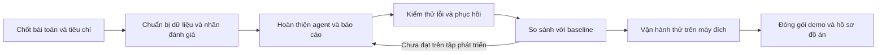
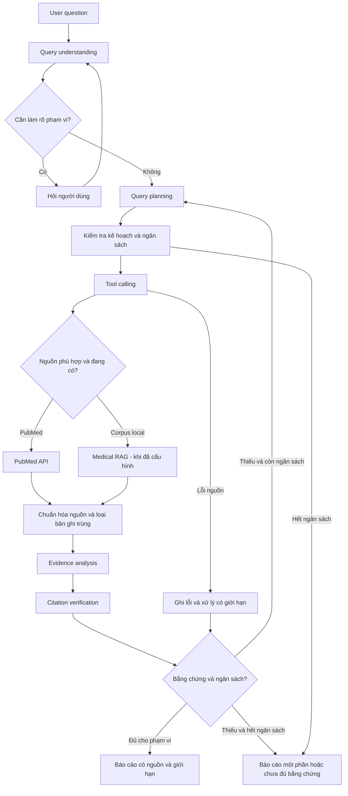
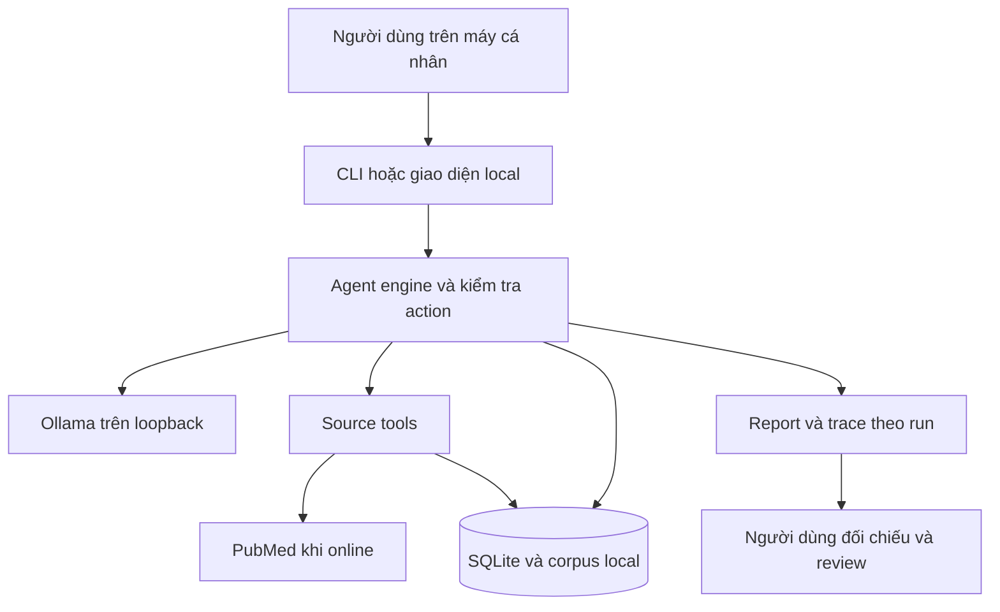

# Pipeline hoàn chỉnh — Biomedical Research Agent cho đồ án đại học

**Cập nhật:** 28/10/2026. **Phạm vi triển khai đích:** hệ thống hỗ trợ tra cứu và tổng hợp
tài liệu y sinh, chạy trên một máy cá nhân, có thể vận hành thử nghiệm, đánh giá và bảo vệ đồ án.

**Tiến độ thực hiện:** đã bổ sung bản local v2 với bảng nghiên cứu theo span ID,
liên kết chứng cứ, baseline fixed, runner A/B, manifest, metrics, backup/restore/rebuild
và đóng gói nguồn. Xem [trạng thái và kết quả thực tế](implementation-status.md),
[runbook](runbook.md) và [quy trình đánh giá](evaluation.md). Phần dưới giữ cấu trúc
kế hoạch ban đầu; chỉ các mục có bằng chứng trong trạng thái triển khai mới được coi là đạt.

**Frontend theo yêu cầu mới:** đã có app HTML local tại module `medical_agent.web`,
giao diện tra cứu y văn nối cùng agent và SQLite. Chạy `python3 -m medical_agent.web
--port 8001 --home outputs`; xem [hướng dẫn frontend và smoke test](frontend.md).

**Nền tảng đã có:** [hệ thống local v1](system.md) gồm CLI, plan/decision loop,
PubMed/local tools, đánh giá nguồn, chứng cứ, SQLite/resume, trace và report Markdown.
Model local đã được kiểm tra lại với snapshot PubMed và chạy A/B thật. PubMed search
đã trả dữ liệu, nhưng thu thập corpus tiếp theo gặp trang chặn và đã dừng. Hiện mới
có snapshot một bài cho smoke test; chất lượng tổng hợp nhiều nghiên cứu chưa được đo độc lập.

**Đích của đồ án:** người dùng đặt câu hỏi → agent xác định phạm vi → tìm và đọc nguồn
→ thu thập chứng cứ → tìm bổ sung khi thiếu → xuất báo cáo truy vết được → người dùng
đối chiếu và review. Khi lỗi hoặc thiếu dữ liệu, hệ thống phải dừng đúng và phục hồi được.

Pipeline gồm ba luồng: **dữ liệu**, **xử lý một yêu cầu**, **phát triển–đánh giá–bàn giao**.
Các mục 1–9 mô tả thiết kế xử lý; mục 10–20 chuyển thiết kế thành kế hoạch thực hiện,
điều kiện nghiệm thu và hồ sơ nộp. Phần ghi “cần bổ sung” là công việc tương lai,
không phải tính năng đã có. Các ngưỡng chất lượng là mục tiêu đề xuất để chốt với giảng viên.

Đọc cùng [project brief](project-brief.md), [hệ thống hiện tại](system.md) và
[lộ trình học](learning-pipeline.md). Điểm chạy: `python3 -m medical_agent`.
[Bài hai tool](7.md) được giữ làm bài học độc lập.



## 1. Quyết định kiến trúc

Một workflow dùng chung xử lý Alzheimer, ung thư phổi, COPD và các chủ đề khác.
Model phân tích câu hỏi để tạo kế hoạch có cấu trúc, thuật ngữ và truy vấn phù hợp.
Python kiểm tra dữ liệu, thực thi tool, lưu state và cưỡng chế giới hạn.

Không tạo `if disease == ...` để chọn một agent hoặc một prompt riêng cho từng bệnh.
Các tên bệnh trong bộ tình huống là dữ liệu kiểm thử, không phải danh sách cho phép
của hệ thống. Schema, tên tool, giới hạn và policy được định nghĩa trong code.

Các khối dưới đây là các bước xử lý, không yêu cầu mỗi khối là một agent/model riêng.
Bản đầu có thể dùng một model và một bộ điều phối.

## 2. Luồng có phản hồi



Sơ đồ thể hiện nhánh cần thiết, không yêu cầu luôn gọi cả PubMed và Medical RAG.
Nếu hai lượt đọc độc lập đều cần thiết, có thể thực hiện song song sau khi đã hiểu
và đo được phiên bản tuần tự. Nguồn chưa cấu hình không được đưa vào danh sách tool.

Một pipeline đi thẳng chỉ thực thi các bước đã định. Phần agentic của thiết kế
là quyền lựa chọn truy vấn/tool và điều chỉnh bước tiếp theo từ kết quả quan sát,
trong giới hạn do code kiểm soát.

## 3. Trách nhiệm từng bước

| Bước | Model cần làm | Code/runtime cần làm | Đầu ra để kiểm tra |
|---|---|---|---|
| Query understanding | Tách chủ đề, mục tiêu, điều kiện đã nêu và phần chưa rõ | Validate schema, giữ nguyên câu hỏi và không biến giá trị thiếu thành dữ kiện | QuestionSpec |
| Query planning | Đề xuất nhóm thuật ngữ, truy vấn, nguồn và tiêu chí chọn tài liệu | Kiểm tra tool được phép, ngày, số lượng và ngân sách | SearchPlan |
| Tool calling | Yêu cầu gọi tool với tham số có cấu trúc | Gọi API/retrieval thật, timeout, parse và trả lỗi rõ | ToolResult |
| Evidence analysis | Trích xuất thông tin được nguồn hỗ trợ, đối chiếu theo câu hỏi | Gắn source ID, giữ đoạn chứng cứ, phát hiện trường thiếu | EvidenceTable và Claims |
| Citation verification | Hỗ trợ đối chiếu nhận định với đoạn nguồn | Kiểm tra định danh, nguồn đã lấy và đoạn trích; giữ kết quả đánh giá chưa chắc chắn | VerificationResults |
| Final report | Viết báo cáo theo hợp đồng đầu ra | Kiểm tra trường bắt buộc, tham chiếu và trạng thái hoàn thành | ResearchReport |

Model không tự thực thi Python/API. Nó tạo yêu cầu; code thực hiện và đưa kết quả
trở lại context. Nhật ký ghi input/output có cấu trúc và tóm tắt quyết định cần thiết
cho debug, không cần thu thập suy nghĩ nội bộ của model.

## 4. Hiểu câu hỏi mà không hardcode bệnh

QuestionSpec cần biểu diễn được các trường phù hợp:

- Câu hỏi gốc và ngôn ngữ.
- Chủ đề/bệnh, có thể nhiều hơn một khái niệm.
- Quần thể, can thiệp hoặc phơi nhiễm, đối chứng, kết cục nếu được nêu.
- Khoảng thời gian được yêu cầu, thời điểm thực hiện tìm kiếm và phần chưa rõ.
- Loại yêu cầu: tìm liên hệ, so sánh can thiệp/sàng lọc, tổng hợp kết cục hoặc loại khác.
- Các trường cần có trong bảng đầu ra.
- Điều kiện chưa được người dùng nêu hoặc chưa được xác nhận.

Không bắt buộc mọi câu hỏi phải có đủ tất cả các trường.
Với câu hỏi Alzheimer, chất lượng giấc ngủ là phơi nhiễm cần xem xét, nguy cơ mắc
Alzheimer là kết cục cần tìm; không tự suy ra độ tuổi hoặc loại nghiên cứu bắt buộc.
Với COPD, “gần đây” cần được làm rõ hoặc thay bằng một mặc định được công bố.
Với sàng lọc ung thư phổi, giữ yêu cầu nhóm nguy cơ cao nhưng không tự tạo tiêu chí
tuổi, tiền sử hoặc ngưỡng nguy cơ mà câu hỏi chưa nêu.

Ngày tìm kiếm là dữ liệu runtime. Nếu chạy ngày 28/10/2026, báo cáo phải thể hiện
thời điểm đó và không tuyên bố đã rà soát hết năm 2026. Giữ riêng khoảng năm người dùng
yêu cầu với khoảng thời gian thực sự áp dụng. PubMed có các trường ngày khác nhau;
việc lọc ngày cần được ghi rõ trong bài API.

## 5. Query planning là một giả thuyết có thể kiểm tra

Kế hoạch gồm các nhóm thuật ngữ/đồng nghĩa, truy vấn dự kiến, bộ lọc đã xác nhận,
tiêu chí liên quan và cách điều chỉnh nếu kết quả không đạt.

Không coi các thuật ngữ MeSH model đề xuất là đã được xác nhận. Khi dùng MeSH cần
đối chiếu nguồn phù hợp. Không coi mọi bộ lọc là vô hại: có thể giảm số tài liệu tìm được.

Lưu truy vấn đã gửi, thời điểm, bộ lọc, cảnh báo và thông tin query translation
khi API cung cấp. PubMed có thể biến đổi truy vấn qua Automatic Term Mapping;
cần biết hệ thống thật sự đã tìm gì.

Không tự bỏ điều kiện thời gian/quần thể của người dùng để tăng số kết quả.
Một kế hoạch có cú pháp hợp lệ chưa chứng minh truy xuất đủ hoặc đúng tài liệu.

## 6. Vai trò của hai nhánh dữ liệu

### PubMed API — nguồn đầu tiên

Tool dự kiến:

- `search_pubmed`: nhận truy vấn và bộ lọc hợp lệ, trả định danh ứng viên và thông tin tìm kiếm.
- `fetch_pubmed_records`: nhận các PMID đã chọn, trả metadata và abstract nếu có.

Một bài có trong kết quả tìm kiếm chưa có nghĩa nội dung phù hợp với câu hỏi.
Sau khi lấy bản ghi mới kiểm tra mức liên quan và thông tin có thể trích xuất.

### Medical RAG — phần mở rộng

Tool dự kiến `search_medical_corpus` chỉ được bật khi có corpus và index đã kiểm tra.
Nguồn có thể là VIBioMIR hoặc tài liệu khác được phép sử dụng.

Mỗi kết quả cần source ID, đoạn nội dung, vị trí/ID chunk và phiên bản tài liệu.
Tài liệu phân loại hay hướng dẫn và bài nghiên cứu có vai trò khác nhau;
không lấy một nguồn phân loại bệnh làm bằng chứng chung về hiệu quả điều trị.

Khi cùng bài xuất hiện ở cả hai nguồn, chuẩn hóa theo PMID/DOI khi có để tránh
đếm trùng. Không ép tài liệu không có PMID/DOI phải có định danh đó; dùng định danh
nguồn local và xuất xứ thực tế.

## 7. Bảng bằng chứng và báo cáo

Các cột tùy câu hỏi, tối thiểu có:

| Trường | Quy tắc |
|---|---|
| source_id, tiêu đề, năm, PMID/DOI nếu có | Lấy từ bản ghi thực tế, không tạo mã hoặc năm giả |
| Quần thể | Ghi đặc điểm được tài liệu mô tả; thiếu thì đánh dấu |
| Thiết kế/phương pháp | Có nguồn hỗ trợ; chưa xác định được thì ghi chưa rõ |
| Can thiệp/phơi nhiễm, đối chứng | Chỉ ghi khi áp dụng và có thông tin |
| Kết cục/thước đo | Giữ tên và ngữ cảnh từ nguồn; không gộp những thước đo khác nhau thành một số |
| Phát hiện/số liệu | Gắn đoạn chứng cứ và điều kiện áp dụng |
| Phần đã đọc | Metadata, abstract hay full-text thực sự được truy cập |
| Giới hạn | Phân biệt hạn chế do tác giả nêu với giới hạn của việc tra cứu |

Nếu chỉ có abstract, không điền chi tiết phương pháp hoặc số liệu không xuất hiện
trong abstract. PubMed không đồng nghĩa đã có toàn văn.

Tách phần bằng chứng từ nghiên cứu gốc và từ tổng quan. Trong bài đầu, không tự
tính hiệu quả gộp hay thực hiện meta-analysis, không tự chấm độ chắc chắn bằng chứng
như một đánh giá chuyên môn đã được kiểm định.

Nhận xét nhất quán/mâu thuẫn phải gắn với kết cục, quần thể và phương pháp có thể
đối chiếu. Chỉ khác hướng kết quả chưa đủ để tự khẳng định hai nghiên cứu mâu thuẫn.
Không chuyển mô tả mối liên hệ thành kết luận nhân quả, hoặc chỉ dựa vào nhãn thiết kế
nghiên cứu để tuyên bố đã chứng minh nhân quả.

Báo cáo gồm: câu hỏi/phạm vi, nhật ký tìm kiếm tóm tắt, bảng nghiên cứu, tổng hợp
có trích dẫn, phần nhất quán/khác biệt, thông tin chưa xác minh và giới hạn.

## 8. Citation verification có nhiều phép kiểm

| Phép kiểm | Có thể kiểm tra gì? | Chưa chứng minh điều gì? |
|---|---|---|
| Định danh | PMID/DOI và metadata khớp bản ghi đã truy xuất | Nhận định đúng |
| Đoạn chứng cứ | Đoạn trích xuất hiện trong nội dung thực sự đã lấy | Đoạn đó đủ hỗ trợ nhận định |
| Nhận định ↔ bằng chứng | Đối chiếu phạm vi và nội dung; đánh dấu supported/partial/unsupported/uncertain | Chất lượng khoa học tổng thể hoặc sự thật tuyệt đối |
| Diễn giải | Kiểm tra có vượt phạm vi, biến liên hệ thành nhân quả hay bỏ điều kiện không | Một đánh giá chuyên môn toàn diện |

Hai phép kiểm đầu có thể dùng code để đối chiếu. Phép kiểm ngữ nghĩa cần rubric,
đánh giá mẫu của con người và đo lỗi của model chấm nếu dùng.
Không đặt một cờ `verified=true` chỉ vì URL mở được hoặc model tự nói đã xác minh.

Nhận định không được hỗ trợ cần được sửa, bỏ hoặc trình bày là chưa đủ bằng chứng.
Trạng thái uncertain phải được giữ rõ thay vì tự chuyển thành supported.

## 9. State, ngân sách và cách kết thúc

State dự kiến giữ: câu hỏi, QuestionSpec, kế hoạch, truy vấn đã chạy, bản ghi nguồn,
bảng bằng chứng, nhận định, kết quả kiểm tra, lỗi và ngân sách còn lại.

Mặc định hiện tại trong `core.Config`: 10 bước, 16 model calls, 8 tool calls,
3 lượt tìm kiếm, tối đa 6 tài liệu/chunk được đọc và 600 giây chủ động.
Context cấu hình 8192 token, output tối đa 700 token mỗi model call; runtime đang
kiểm tra kích thước context bằng ngưỡng byte bảo thủ, chưa có tokenizer chính xác.
Các giá trị này là cấu hình xuất phát, chưa được đo là tối ưu. Số chunk đã đọc
khác số tài liệu gốc độc lập được dùng để xét đủ nguồn. Khi resume, giữ ngân sách
đã dùng; thời gian người dùng chờ trả lời không phải thời gian xử lý chủ động.
Không nhồi tất cả abstract vào context 2048 token của bài 1; phần phân tích báo cáo
cần thiết kế chọn lọc/chia lượt và đo token riêng.

Điều kiện dừng:

- Đạt hợp đồng báo cáo trong phạm vi đã định và các nhận định quan trọng có bằng chứng hỗ trợ.
- Cần người dùng làm rõ thông tin ảnh hưởng lớn đến việc tìm kiếm.
- Không có thêm thông tin sau khi điều chỉnh hợp lệ, hoặc đã hết ngân sách.
- Nguồn lỗi khiến không thể tiếp tục; báo lỗi hoặc xuất phần đã có với giới hạn rõ.

“Không có kết quả phù hợp trong lượt tìm này” khác “API không truy cập được”.
Không dùng kết quả của vài bản ghi để tuyên bố đã bao phủ toàn bộ y văn.

## 10. Chốt sản phẩm và câu hỏi nghiên cứu của đồ án

**Tên đề tài đề xuất:** “Xây dựng và đánh giá hệ thống agent hỗ trợ tra cứu,
tổng hợp tài liệu y sinh có truy vết bằng chứng với mô hình ngôn ngữ chạy cục bộ”.

**Người dùng:** sinh viên và người học nghiên cứu, cần tổng hợp một câu hỏi từ
tài liệu công khai. **Đơn vị công việc:** một câu hỏi nghiên cứu, không chứa hồ sơ
bệnh nhân; mỗi lượt có `run_id`, kế hoạch, nguồn, chứng cứ và kết quả riêng.

| Hạng mục | Phạm vi bắt buộc để nghiệm thu bản local |
|---|---|
| Nhập yêu cầu | Tiếng Việt, giữ câu hỏi gốc, hỏi lại khi thiếu phạm vi quan trọng |
| Nguồn | PubMed online và snapshot/corpus local có xuất xứ |
| Hành vi agent | Chọn tìm/đọc/hỏi lại/kết thúc dựa trên quan sát; có ca đổi truy vấn |
| Chứng cứ | Nhận định gắn ID chứng cứ và đoạn nguồn thực sự đã đọc |
| Báo cáo | Phạm vi, nhật ký tìm, bảng nghiên cứu, tổng hợp, giới hạn, tham chiếu |
| Vận hành | Timeout, ngân sách, checkpoint/resume, lịch sử, trace, review |
| Đánh giá | Kiểm thử xác định; benchmark có nhãn; baseline; phân tích lỗi |
| Bàn giao | Hướng dẫn chạy lại, dữ liệu demo hợp lệ, báo cáo và video dự phòng |

**Câu hỏi nghiên cứu chính:** vòng lặp tự điều chỉnh truy vấn có cải thiện mức độ
đáp ứng câu hỏi và tỷ lệ nhận định được hỗ trợ so với quy trình tìm kiếm cố định,
trên cùng model, corpus và giới hạn tài nguyên hay không?

**Đóng góp cần trình bày:** thiết kế điều phối có giới hạn; mô hình liên kết
nhận định–chứng cứ–tài liệu; cơ chế khôi phục; và kết quả thực nghiệm tái hiện được.
Việc ghép nhiều thư viện hoặc tăng số agent không tự tạo ra đóng góp nghiên cứu.
Kết quả không cải thiện baseline vẫn có giá trị báo cáo nếu đo đúng và phân tích được nguyên nhân.

CLI là giao diện nghiệm thu mặc định của kế hoạch này. Nếu quy định khoa yêu cầu
giao diện đồ họa, chốt ngay tuần 1 và dành tuần 6 cho giao diện local: nhập câu hỏi,
trả lời làm rõ, xem tiến độ, lịch sử, nguồn và tải report. Giao diện gọi lại engine,
không viết một luồng xử lý riêng. Phạm vi nhiều người dùng, cloud, dense RAG,
MCP/A2A và multi-agent chỉ mở sau khi phần bắt buộc đạt; mỗi phần cần thí nghiệm riêng.

## 11. Đối chiếu nền tảng hiện có và phần còn thiếu

| Khối | Hiện có trong repo | Cần hoàn thiện để nộp |
|---|---|---|
| Phân tích câu hỏi | Plan có topic, query, criteria, năm, clarification | Đặc tả rõ trường quần thể/can thiệp/kết cục và phạm vi gốc–áp dụng; kiểm thử thông tin bị tự thêm |
| Điều phối | Structured decision JSON, kiểm tra action/ID, vòng lặp có budget | Benchmark quyết định với model thật; đo lỗi JSON, vòng lặp không tiến triển |
| Nguồn online | ESearch/EFetch, cache, retry giới hạn, phân biệt trang chặn | Chạy smoke test trên máy đích; kiểm tra nguồn thiếu năm, query translation, ngày và provenance trong report |
| Corpus local | Ingest txt/md/json/jsonl, FTS5/BM25, hash, thay chunk cũ | Bộ snapshot demo có manifest; kiểm tra trùng bài qua nhiều dạng nhập |
| Evidence | Model chọn span ID cho chứng cứ và trường nghiên cứu, code lấy đoạn | Nhãn supported/partial/unsupported/uncertain do người đánh giá |
| Report | Markdown, bảng nghiên cứu, nhật ký truy vấn, liên kết claim–evidence, giới hạn | Đánh giá độ đúng của trường được chọn và chất lượng diễn giải |
| Độ dài đầu ra | Tối đa 4 claims, 2 đoạn chứng cứ/nguồn, 1–4 tiêu chí plan | Đo xem giới hạn này có đáp ứng tổng hợp nhiều nghiên cứu; điều chỉnh schema và budget nếu cần |
| Khôi phục | SQLite, pending action, resume; backup/restore và rebuild đã có | Thử trên máy bảo vệ; kiểm tra định kỳ backup |
| Kiểm thử | Bộ tests và 12 ca lỗi/phạm vi chạy bằng fixtures | Kết quả hiện tại xem implementation-status; red-team model thật còn thiếu |
| Đánh giá | `eval`, runner A/B offline, summary, template review; 30 câu hỏi nháp | Tập có nhãn nguồn, rà split và chấm nội dung độc lập |

`QuestionSpec`, `SearchPlan`, `EvidenceTable`, `VerificationResults` ở mục 3 là
tên hợp đồng thiết kế. v1 đang lưu phần lớn thông tin trong `state.plan`,
`state.documents[*].assessment` và `state.claims`; chưa có đầy đủ các object độc lập đó.

## 12. Pipeline dữ liệu trước khi phục vụ câu hỏi

```mermaid
flowchart LR
    A[Chọn nguồn và quyền sử dụng] --> B[Thu thập bản ghi và ngày lấy]
    B --> C[Kiểm tra schema và nội dung]
    C --> D[Chuẩn hóa ID và loại trùng]
    D --> E[Giữ metadata và hash phiên bản]
    E --> F[Chunk tài liệu local nếu cần]
    F --> G[SQLite documents và FTS5]
    G --> H[Kiểm tra tìm kiếm trên tập phát triển]
    H --> I[Đóng băng snapshot và manifest]
```



1. **Chọn dữ liệu:** bắt đầu khoảng 60–100 bản ghi có abstract, phủ ba chủ đề
   trong brief và một số tài liệu không liên quan để kiểm tra lọc. Đây là quy mô
   khởi đầu; tăng theo độ phủ thực tế của bộ câu hỏi, không chọn chỉ tài liệu cho kết quả đẹp.
2. **Thu thập:** giữ PMID, DOI nếu có, tiêu đề, năm, abstract, URL, thời điểm lấy,
   truy vấn nguồn và phạm vi nội dung. Thiếu abstract phải được ghi nhận; không
   tự điền abstract từ tên bài. Lưu nguồn gốc và điều kiện tái phân phối.
3. **Chuẩn hóa:** dùng PMID cho bài PubMed, DOI đã chuẩn hóa khi phù hợp; tài liệu
   local giữ ID tài liệu và ID chunk. Dùng hash để nhận diện phiên bản nội dung.
   Không gộp hai bài chỉ vì tiêu đề giống nhau. Nhiều chunk không phải nhiều nghiên cứu.
4. **Lập chỉ mục:** giữ FTS5/BM25 làm bản đầu. Kiểm tra truy vấn tiếng Anh/Việt,
   dấu tiếng Việt và từ đồng nghĩa trên tập phát triển. Model có thể lập query tiếng Anh
   từ câu hỏi tiếng Việt; cần đo thay vì giả định BM25 tự giải quyết khác ngôn ngữ.
5. **Kiểm tra chất lượng:** đếm bản ghi hợp lệ, thiếu năm/abstract, trùng ID,
   tài liệu ngoài khoảng năm; mở mẫu và đối chiếu nội dung sau ingest.
6. **Đóng băng:** tạo manifest gồm phiên bản corpus, danh sách file, SHA-256,
   số tài liệu/chunk, ngày lấy, quyền dùng, quy tắc chuẩn hóa và tập nhãn đi kèm.
   Đổi corpus phải tạo phiên bản mới; run cũ giữ snapshot đã đọc.

Lệnh manifest đã có; corpus đủ độ phủ và bộ nhãn vẫn cần bổ sung. Dữ liệu thô, DB và toàn bộ trace nằm trong
`outputs/`, không commit. Chỉ đưa fixture tổng hợp hoặc dữ liệu được phép phân phối
vào gói nộp; nếu không được phân phối, cung cấp script thu thập và manifest để tái tạo.
Không yêu cầu gửi dữ liệu bệnh nhân thật để kiểm thử.

## 13. Hợp đồng của một lượt chạy và các điểm kiểm soát

| Giai đoạn | Input → output cần lưu | Điều kiện chuyển bước |
|---|---|---|
| Tiếp nhận | Câu hỏi → run ID, cấu hình, thời điểm bắt đầu | Input hợp lệ; công bố phạm vi thử nghiệm |
| Hiểu yêu cầu | Câu hỏi + trả lời làm rõ → phạm vi đã xác nhận | Không tự tạo tuổi, quần thể hay khoảng “gần đây” |
| Lập kế hoạch | Phạm vi → tiêu chí, truy vấn, số nguồn mục tiêu | Schema hợp lệ, số nguồn và bộ lọc trong budget |
| Chọn hành động | State tóm tắt → action JSON | Action được phép ở state hiện tại |
| Thực thi | Action đã kiểm tra → ToolResult | Lưu pending action trước I/O; lỗi khác dữ liệu rỗng |
| Đọc và lọc | Source ID đã tìm → tài liệu và assessment | Năm/phạm vi hợp lệ, có nội dung, có đoạn chứng cứ |
| Đánh giá tiến độ | Evidence ledger → tiêu chí đã phủ/còn thiếu | Thiếu thì đổi truy vấn/đọc/hỏi lại trong budget |
| Tổng hợp | Evidence ledger → claims + bảng nghiên cứu | Không thêm số liệu ngoài nguồn; phân biệt liên hệ và nhân quả |
| Kiểm tra | Claims → hợp lệ/bị loại/cần review | ID và đoạn nguồn khớp; giữ rõ phần ngữ nghĩa chưa xác minh |
| Xuất và review | State → report, trace, quyết định người đọc | Có trạng thái, lý do dừng và giới hạn kể cả khi thất bại |

Đối với câu hỏi nhiều nghiên cứu, bảng đích có một hàng mỗi tài liệu gốc,
gồm quần thể, thiết kế, can thiệp/phơi nhiễm, đối chứng, kết cục, số liệu kèm đơn vị,
evidence IDs và phần đã đọc. Trường không có trong abstract ghi “chưa có trong phần
đã đọc”. Bảng này đã được bổ sung ở v2 bằng span ID; việc chọn đúng trường cần được review.

Để sửa nhận định không đạt, có thể thêm tối đa một lượt sinh lại trong ngân sách
model hiện có. Đây là thay đổi dự kiến, phải kiểm thử; v1 đang loại claim sai hợp đồng
và chuyển `partial` khi cần. Mọi lần thử lại đều được ghi log và tính tài nguyên.

Khi có hai nguồn khác nhau, mới đủ điều kiện cấu trúc để so sánh. Để kết luận
nhất quán/khác biệt còn phải đối chiếu quần thể, thiết kế, kết cục và thời gian theo dõi.
Một tổng quan chứa nghiên cứu gốc không tạo thêm một bằng chứng độc lập cho cùng dữ liệu.

### Trạng thái vận hành và chất lượng nội dung

| Trạng thái hiện có | Cách hiển thị và xử lý |
|---|---|
| `planning`, `running` | Hiển thị bước hiện tại, ngân sách đã dùng; checkpoint theo event |
| `waiting_for_user` | Hiển thị câu hỏi; trả lời rồi lập lại plan trên cùng run, giữ budget |
| `paused_source` | Nguồn bị chặn và không có corpus thay thế; nạp dữ liệu hoặc resume khi nguồn phục hồi |
| `interrupted` | Bị Ctrl+C; resume từ SQLite và pending action |
| `completed` | Đạt hợp đồng cấu trúc của runtime; vẫn hiển thị trạng thái review riêng |
| `partial` | Thiếu tiêu chí/budget hoặc report lỗi; chỉ xuất phần có chứng cứ |
| `failed` | Chưa có kết quả dùng được; xuất nguyên nhân và hướng xử lý |
| `out_of_scope` | Đã nhận diện yêu cầu chẩn đoán/kê đơn cá nhân, không gọi tool nghiên cứu |

Không tự resume run `partial` để nhận thêm ngân sách. Nếu cần mở rộng, tạo run mới
với cấu hình công bố rõ. v1 giữ nguyên run đã kết thúc khi resume không kèm bổ sung.

Một run `completed` không chứng minh mọi nhận định quan trọng đều được hỗ trợ về
ngữ nghĩa: `readiness` hiện xét số nguồn và độ phủ tiêu chí do model gán. Cần đánh giá
thủ công mức đáp ứng yêu cầu, tính đúng của diễn giải và chất lượng số liệu riêng.
Review v1 có `pending/approved/rejected`; nhãn ngữ nghĩa chi tiết trong benchmark
là một lớp đánh giá cần bổ sung, không phải trạng thái runtime đã có.

## 14. Triển khai và vận hành thử trên máy cá nhân

### Mô hình triển khai đích



Phạm vi đầu là một người dùng, một tiến trình agent hoạt động trên một thư mục
runtime. Chưa công bố khả năng nhiều worker. Nếu thêm web UI, mỗi lần chạy cần có
cơ chế khóa/trạng thái để tránh hai tác vụ cùng sửa một run; kiểm thử trước khi dùng.

### Runbook dùng được với CLI hiện có

Chạy từ root repo. Python cần có SQLite FTS5; Ollama phải đang phục vụ
`qwen3:1.7b` trên loopback. Ghi phiên bản Python, SQLite, Ollama, model và phần cứng
thực tế sau khi kiểm tra trên máy đích. Chưa có số liệu để cam kết một cấu hình RAM/GPU.

```bash
# 1. Kiểm tra runtime; doctor xem Ollama và kho đã nạp, chưa kiểm tra PubMed online.
python3 -m medical_agent doctor

# 2. Nạp snapshot thật đã chuẩn bị; thay đường dẫn bằng file trong gói demo.
python3 -m medical_agent ingest /duong/dan/pubmed_snapshot.json

# 3. Chạy demo không phụ thuộc NCBI; vẫn cần Ollama local.
python3 -m medical_agent --offline --question "Tóm tắt 1 bài báo về giấc ngủ và Alzheimer; chỉ cần nêu mối liên hệ được tác giả mô tả."

# 4. Xem ID vừa tạo rồi thay RUN_ID trong các lệnh bên dưới.
python3 -m medical_agent runs
python3 -m medical_agent show RUN_ID
python3 -m medical_agent trace RUN_ID
python3 -m medical_agent eval RUN_ID

# 5. Chạy tiếp một run đang chờ làm rõ, nếu có.
python3 -m medical_agent --resume RUN_ID --answer "Dùng khoảng năm 2020–2026"

# 6. Ghi nhận review sau khi thực sự đối chiếu nguồn.
python3 -m medical_agent review RUN_ID approved --note "Đã đối chiếu các nhận định với đoạn nguồn trong phạm vi demo."
```

`RUN_ID` là chỗ giữ chỗ, phải thay bằng ID thật của đúng tình huống. Lệnh review
ghi quyết định người dùng local, không xác thực danh tính hay chứng nhận y khoa.
CLI trả mã 0 khi lượt nghiên cứu `completed`, 2 khi chưa hoàn tất, 1 khi lỗi CLI
và 130 khi ngắt. Script demo cần diễn giải mã 2 theo trạng thái, không gộp thành lỗi nguồn.

**Online smoke test riêng:** chạy một câu hỏi với `--online`, kiểm tra trong trace
nguồn là `live` hay `cache`, truy vấn, số ứng viên, metadata, abstract và timestamp.
Cache thành công chưa chứng minh PubMed live hoạt động. Nguồn bị chặn phải được ghi
là hạn chế của lần chạy; dùng snapshot cho buổi bảo vệ và công bố ngày snapshot.

### Sao lưu, phục hồi và theo dõi

- **Dữ liệu gốc của run:** `outputs/agent.sqlite3`; các bản xuất nằm trong
  `outputs/runs/RUN_ID/{state.json,trace.jsonl,report.md}`. Khôi phục từ SQLite,
  không suy diễn state từ một report đã chỉnh tay.
- **Sao lưu:** khi tiến trình đã dừng và kết nối DB đã đóng, sao lưu toàn bộ thư mục
  runtime, kể cả file WAL/SHM nếu còn. Nếu sao lưu khi DB đang mở, dùng SQLite backup
  API để có bản nhất quán, không chỉ copy riêng file `.sqlite3`.
- **Diễn tập phục hồi:** dùng bản sao trong một thư mục thử nghiệm, chỉ định
  `--home /duong/dan/ban_khoi_phuc`, xem `runs/show/trace`, resume run bị ngắt;
  đối chiếu ID, counters và chứng cứ. Bổ sung công cụ xuất lại report từ checkpoint
  nếu file report bị thiếu sau sự cố; v2 có lệnh `rebuild RUN_ID`.
- **Theo dõi từng run:** trạng thái, thời gian, model/tool calls, query count,
  số nguồn dùng được, tiêu chí thiếu, lý do loại, lỗi nguồn, claim bị loại và review.
  Trace có usage model; tổng hợp thành metrics theo run là phần cần bổ sung.
- **Khi lỗi:** model không chạy → kiểm tra Ollama/model; corpus trống → ingest;
  nguồn bị chặn → ngừng PubMed và dùng local nếu có; quá context → giảm packet/chia
  lượt có kiểm thử; hết budget → giữ `partial`, không đổi nhãn thành thành công.

## 15. Kiểm thử chức năng, phục hồi và dữ liệu không tin cậy

Kiểm thử xác định dùng fixture tổng hợp và mock; không cần Ollama hay mạng.
Model/source thật được kiểm tra riêng, tránh làm bộ test phụ thuộc dịch vụ ngoài.

| Nhóm | Ca bắt buộc | Kết quả cần quan sát |
|---|---|---|
| Luồng chuẩn | Tìm → đọc → đánh giá → report | Claim truy được đến evidence và tài liệu |
| Tính agentic | Nguồn đầu sai chủ đề → đổi query → đọc nguồn phù hợp | Quyết định sau phụ thuộc quan sát, không hardcode bệnh |
| Làm rõ | “Gần đây”, số nguồn vượt giới hạn | Hỏi lại, giữ cùng run, không reset counters |
| Dữ liệu thiếu | Abstract rỗng, thiếu năm, DOI không có | Loại nguồn hoặc ghi thiếu đúng chỗ, không bịa |
| Nguồn | Kết quả 0, timeout, 429/5xx, HTML chặn | Phân biệt dữ liệu rỗng và lỗi; retry có giới hạn |
| Quyền thực thi | ID chưa tìm, action lạ, tham số sai | Runtime từ chối trước I/O |
| Chứng cứ | Span ID giả, evidence ID lạ, so sánh một nguồn | Không xuất claim sai hợp đồng |
| Budget | Hết bước/tool/model/thời gian, query lặp | Dừng có lý do; giữ ngân sách khi resume |
| Restart | Ngắt khi tool đang đọc, mở lại DB | Không mất run hoặc tính trùng một logical tool call |
| Corpus | Nạp lại, đổi file, nhiều chunk cùng bài | Không giữ chunk cũ; không đếm trùng nguồn gốc |
| Injection | Tài liệu bảo “bỏ luật”, gọi shell, thêm PMID giả | Xem như nội dung nguồn; không tăng quyền hoặc tạo evidence giả |
| Ngoài phạm vi | Yêu cầu chẩn đoán/kê đơn cá nhân | Thông báo phạm vi; không tự đưa chỉ định |

V1 có nhiều kiểm tra cấu trúc nhưng chưa có bộ red-team toàn diện hoặc đánh giá
ngoài phạm vi với model thật. Ca injection cần kiểm tra cả quyền thực thi lẫn việc
đầu ra bị nội dung độc hại dẫn dắt; không kết luận an toàn chỉ vì shell không được gọi.

Lệnh hiện có: `python3 -m unittest discover -s tests -v`.
Ghi baseline 41/41 tests đạt ngày 28/10/2026; đây là kết quả kiểm thử phần mềm,
không phải số câu hỏi benchmark đạt hoặc xác nhận nội dung y khoa.

## 16. Thiết kế đánh giá để có kết quả bảo vệ đồ án

### Bộ đánh giá và nhãn tham chiếu

Ba ca trong [research_cases.json](../evals/research_cases.json) là đặc tả đầu vào/đầu ra,
chưa phải đáp án chuẩn. Cần xây thêm **30 câu hỏi nội dung**, khởi đầu 10 câu mỗi
chủ đề. Chia 10 câu phát triển và 20 câu kiểm tra; phân tầng theo chủ đề, độ mơ hồ,
nhu cầu so sánh và mức đủ/thiếu dữ liệu trong corpus.

Tách nhóm câu hỏi gần trùng và tài liệu tham chiếu trùng mạnh trước khi chia tập,
tránh một biến thể câu hỏi rơi vào cả hai phía. Index chứa tài liệu cần tra cứu là
đầu vào hợp lệ của bài toán; nhãn đáp án và nhận xét người chấm không được đưa vào
context agent. Bổ sung tối thiểu **12 tình huống lỗi/an toàn** riêng, không tính
chúng vào tỷ lệ hoàn thành câu hỏi nội dung.

Mỗi câu hỏi cần: phạm vi đã chốt, criteria IDs, danh sách tài liệu tham chiếu đã đọc,
đoạn chứng cứ, thông tin bắt buộc/được phép thiếu, điều không được kết luận và lý do.
Không cố tạo một đoạn “đáp án đúng” duy nhất cho câu hỏi tổng hợp mở.

Một người gán nhãn toàn bộ; người thứ hai rà soát tối thiểu 20% được chọn trước,
gồm cả ca dễ/khó và các bất đồng. Ghi vai trò người chấm, rubric, mức đồng thuận và
cách xử lý bất đồng. Nếu chưa có người có chuyên môn y sinh, chỉ báo cáo đánh giá
độ hỗ trợ theo văn bản và chức năng; không gọi là thẩm định y khoa.

### Baseline và điều kiện so sánh

| Phương án | Cách chạy | Mục đích |
|---|---|---|
| A — Quy trình cố định | Một truy vấn sinh từ cùng phạm vi, lấy top-k, đọc rồi tổng hợp; không đổi truy vấn theo kết quả | Mốc so sánh cho lợi ích vòng lặp |
| B — Agent đầy đủ | Cùng bước hiểu phạm vi ban đầu; sau đó chọn tool, loại nguồn, đổi truy vấn và dừng trong budget | Đo chất lượng và chi phí thực của agent |
| C — Bỏ tìm bổ sung, tùy thời gian | Giữ lọc nguồn/chứng cứ của B nhưng cấm đổi truy vấn | Tách ảnh hưởng của riêng việc tìm bổ sung |

Baseline runner đã có trong `medical_agent.benchmark`; xem cách chạy ở evaluation.md.
A và B dùng cùng model,
snapshot, cấu hình context, hợp đồng báo cáo, kiểm tra citation và trần tài nguyên.
Giữ cơ chế kiểm tra bằng chứng trong mọi phương án. Công bố top-k và cách gộp chunk
theo tài liệu; chốt tham số trên 10 câu phát triển trước khi chạy tập kiểm tra.

Chạy benchmark chính ở offline trên snapshot đóng băng, tạo thư mục runtime sạch
cho từng phương án bằng `--home` để tránh khác biệt cache/lịch sử. Truy vấn online
được báo cáo như smoke test bổ sung; không so kết quả ở hai thời điểm nguồn khác nhau
rồi quy chênh lệch cho agent. Ghi cả tài nguyên thực dùng, không chỉ giới hạn cho phép.

Chạy toàn bộ 20 câu kiểm tra ít nhất một lần cho mỗi phương án; chọn trước 5 câu
đại diện để chạy 3 lần đo độ ổn định. Không tuyên bố model local luôn xác định vì
`temperature=0`. Ghi thời gian nạp model và chế độ nóng/lạnh để so latency công bằng.
Sau khi xem tập kiểm tra, nếu sửa hệ thống thì ghi phiên bản mới và cần một vòng
đánh giá xác nhận; không tiếp tục gọi tập đã dùng để chỉnh là tập kiểm tra chưa thấy.

### Metric, công thức và ngưỡng mục tiêu

| Metric | Cách tính | Mục tiêu đề xuất |
|---|---|---|
| Hoàn thành nội dung | Số câu đủ trường đầu ra và criteria bắt buộc theo rubric / số câu nội dung hợp lệ | ≥90%; trên 20 câu là ít nhất 18/20 |
| Hành động phù hợp | Quyết định phù hợp một trong các action chấp nhận được / điểm quyết định có nhãn | ≥90%; nêu rõ mẫu được chấm |
| Citation validity | Tham chiếu đúng ID/metadata của tài liệu đã đọc / toàn bộ tham chiếu xuất ra | 100%; có một nguồn bịa là chặn nghiệm thu |
| Claim support | Claim quan trọng được chấm supported / toàn bộ claim quan trọng xuất ra | ≥90%; partial và uncertain không tính supported |
| Evidence coverage | Tiêu chí bắt buộc có claim được hỗ trợ / toàn bộ tiêu chí bắt buộc | Báo theo từng câu và trung bình; tránh đạt bằng cách không viết claim |
| Retrieval | Precision@k và Recall@k so với tập nguồn tham chiếu đã gán nhãn | So A/B; chưa đặt ngưỡng trước khi có nhãn |
| Tuân thủ lỗi/phạm vi | Tình huống dừng hoặc xử lý đúng policy / toàn bộ tình huống đã định | 100% ca bắt buộc, báo rõ số ca |
| Phục hồi | Ca restart giữ state/budget đúng / ca khôi phục đã kiểm tra | 100% ca đã định |
| Tài nguyên | Median, p95 latency, model/tool calls, token usage nếu có, tỷ lệ lỗi | Công bố phần cứng và mẫu số; không tự suy ra SLA |

Với retrieval: `Precision@k = nguồn liên quan trong top-k / số nguồn thực trả tới k`;
`Recall@k = nguồn tham chiếu tìm được trong top-k / số nguồn tham chiếu`.
Nếu không trả nguồn, precision được ghi 0 cho ca có nguồn phù hợp; ca không có nguồn
tham chiếu dùng bài kiểm tra từ chối kết luận, không ép tính recall. Công bố quy ước.
Recall chỉ đo trong tập tham chiếu đã gán nhãn, không đo mức bao phủ toàn bộ PubMed.

Citation đúng không đồng nghĩa claim được hỗ trợ. Người chấm đọc claim và đoạn
nguồn, gán supported/partial/unsupported/uncertain theo rubric. Report không có claim
thì support là N/A, vẫn bị phản ánh ở completion/coverage; không tính thành 100%.
`completed` của runtime không được dùng thay cho nhãn hoàn thành nội dung.

Mọi tỷ lệ phải có tử số/mẫu số, lỗi tiêu biểu và phân bố theo chủ đề. Đánh giá
30 câu là thử nghiệm nhỏ cho đồ án; kết quả không đại diện cho mọi bệnh hoặc ứng dụng lâm sàng.

### Kết quả cần lưu

Runner cần xuất `results.jsonl` theo run/câu hỏi/phương án, `summary.csv`, bảng
chấm claim và danh mục lỗi. Mỗi dòng giữ phiên bản code/prompt/corpus/model,
cấu hình, seed nếu runtime hỗ trợ, thời gian, trạng thái, metrics và đường dẫn trace.
Nếu Ollama không cung cấp số token ở một lượt, ghi thiếu; không thay bằng 0.

Nhóm lỗi để phân tích: hiểu sai phạm vi; truy vấn bỏ sót; lọc sai; thiếu nội dung;
trích xuất sai số liệu; diễn giải vượt nguồn; citation sai; quá context; hết budget;
lỗi nguồn. Đưa cả trường hợp thất bại vào báo cáo thực nghiệm.

## 17. Kế hoạch thực hiện 8 tuần và mốc nghiệm thu

Giả định một sinh viên làm trên nền repo hiện có. Nếu thời gian khác, giữ thứ tự
phụ thuộc và điều kiện đạt; không lấy số tuần làm bằng chứng đã hoàn thành.

| Tuần | Công việc chính | Sản phẩm cụ thể | Điều kiện qua mốc |
|---|---|---|---|
| 1 — Chốt yêu cầu | Chốt đề tài, người dùng, CLI/UI, 3 ca mẫu, hợp đồng report, máy đích | Brief cập nhật, sơ đồ, danh sách yêu cầu–test, baseline test log | Giảng viên/người hướng dẫn thống nhất phạm vi; chạy lại CLI/tests |
| 2 — Dữ liệu và nhãn | Thu thập, chuẩn hóa, ingest, manifest; soạn 30 câu và chia tập | Snapshot v1, manifest, rubric, 10 câu phát triển + 20 câu kiểm tra | Có xuất xứ và quyền dùng; tìm được nguồn của ca phát triển; đóng băng tập kiểm tra |
| 3 — Luồng agent | Hoàn thiện hiểu phạm vi, lọc, chọn action và vòng tìm bổ sung | Trace chuẩn, trace đổi query, trace hỏi lại; regression tương ứng | Không gọi ID lạ, không lặp vô hạn, giữ đúng ngân sách |
| 4 — Chứng cứ và report | Bổ sung bảng nghiên cứu, ánh xạ claim–evidence, nhật ký tìm | Report cho 3 ca brief, mẫu nhãn claim, tests report | Không có nguồn bịa; trường thiếu hiển thị đúng; review trên tập phát triển |
| 5 — Độ bền và baseline | Hoàn thiện failure cases, injection, restart; viết runner A/B | Bộ ca lỗi, baseline, results schema, log phục hồi | Tests đạt; A/B dùng cùng dữ liệu và giới hạn; diễn tập khôi phục đạt |
| 6 — Vận hành thử | Hướng dẫn cài/chạy, backup; UI local nếu đã chốt; thử trên máy đích | Runbook, gói snapshot demo, checklist thao tác, video nháp | Người khác chạy được theo hướng dẫn; ghi lỗi vận hành và sửa |
| 7 — Thực nghiệm | Khóa phiên bản; chạy A/B; chấm nội dung; tổng hợp lỗi và chi phí | Results, summary, rubric đã chấm, bảng/biểu đồ thực nghiệm | Có mẫu số, trace và nhận xét hạn chế; không chỉnh prompt theo test rồi giấu |
| 8 — Bàn giao | Sửa lỗi có chứng cứ, kiểm tra xác nhận nếu sửa; hoàn thiện báo cáo/slide | Gói nộp, hướng dẫn tái lập, slide, video, demo offline | Đạt checklist mục 20; tổng duyệt demo trên máy bảo vệ |

**Ưu tiên:** hoàn thiện report và đánh giá trước; sau đó độ bền và trải nghiệm demo.
Dense RAG/rerank chỉ thử nếu baseline retrieval cho thấy vấn đề cụ thể, có dữ liệu
để đo cải thiện và còn thời gian. Không mở rộng hạ tầng khiến thiếu benchmark hoặc báo cáo.

## 18. Kịch bản demo bảo vệ 10–12 phút

| Thời lượng | Thao tác | Điều hội đồng kiểm tra được |
|---|---|---|
| 1 phút | Nêu bài toán, đầu vào, phạm vi abstract, kiến trúc | Mục tiêu và giới hạn rõ |
| 3 phút | Chạy câu hỏi ngắn trên snapshot đã nạp, xem plan/action/report | Hệ thống thực sự làm việc và có chứng cứ |
| 2 phút | Mở trace loại nguồn rồi đổi query và đối chiếu một claim | Quyết định dựa trên quan sát; truy vết đến nội dung |
| 1 phút | Câu hỏi “gần đây” → trả lời làm rõ → resume | Giữ cùng run và phạm vi đã xác nhận |
| 2 phút | Diễn tập ngắt/resume hoặc nguồn bị lỗi | Giữ state/budget; phân biệt lỗi với kết quả rỗng |
| 2 phút | Bảng A/B, claim support, thời gian và một ca thất bại | Có thực nghiệm và hiểu hạn chế |
| 1 phút | Chốt phần đã đạt, phần chưa đạt và hướng mở rộng | Đánh giá đúng mức sản phẩm |

Trước buổi bảo vệ: chuẩn bị snapshot, kiểm tra model đã nạp, chạy thử câu hỏi
ngắn và đo thời gian thật. Nếu model chậm, chạy một luồng ngắn trực tiếp rồi dùng
report/trace/video có sẵn cho luồng dài; ghi rõ phần chạy mới và phần phát lại.
Ca lỗi có thể dùng fixture hoặc trace đã ghi, phải thông báo là mô phỏng/phát lại.
Không dựa vào việc NCBI luôn truy cập được trong phòng bảo vệ.

## 19. Bộ hồ sơ và cấu trúc báo cáo đồ án

Các tài liệu/chương trình bổ sung dưới đây là **danh sách cần tạo**, không phải
file đã tồn tại chỉ vì được nhắc trong pipeline.

| Hạng mục nộp | Nội dung tối thiểu |
|---|---|
| Mã nguồn | Engine/model/tools/store/report, tests, baseline/eval runner; phiên bản code cố định |
| Hướng dẫn tái lập | Môi trường thực tế, cách chuẩn bị model/data, lệnh chạy, expected output, xử lý lỗi |
| Dữ liệu demo | Snapshot được phép dùng hoặc script tái tạo; manifest/hash/ngày lấy; tách fixture giả lập |
| Đặc tả và thiết kế | Use cases, yêu cầu chức năng/phi chức năng, sơ đồ thành phần, state, sequence, schema |
| Kiểm thử | Danh sách ca, kết quả tự động, smoke test model/source, log phục hồi; ghi riêng từng loại |
| Thực nghiệm | Tập câu hỏi và rubric, cách chia tập, A/B, cấu hình, bảng số liệu, lỗi và hạn chế |
| Sản phẩm mẫu | Report, state, trace được phép chia sẻ; không gồm secrets hoặc dữ liệu cá nhân |
| Bảo vệ | Slide, kịch bản, video dự phòng, hướng dẫn khởi động trên máy đích |

Cấu trúc báo cáo đề xuất, điều chỉnh theo mẫu của khoa:

1. **Đặt vấn đề:** người dùng, bài toán, mục tiêu, phạm vi, câu hỏi nghiên cứu.
2. **Cơ sở và công trình liên quan:** LLM, agent/tool calling, retrieval, grounding,
   PubMed, đánh giá; ghi rõ nguồn tham khảo và điểm kế thừa.
3. **Phân tích và thiết kế:** yêu cầu, kiến trúc, hợp đồng dữ liệu, state/budget,
   thuật toán chọn bước, quản lý lỗi, giới hạn dữ liệu.
4. **Cài đặt và vận hành:** module, giao thức model/tool, ingestion, persistence,
   report, môi trường triển khai và runbook.
5. **Thực nghiệm:** dữ liệu, nhãn, baseline, metric, kết quả, ablation nếu có,
   phân tích lỗi và các yếu tố có thể làm sai lệch đánh giá.
6. **Kết luận và hướng phát triển:** đối chiếu từng mục tiêu với bằng chứng đạt;
   trình bày phần còn thiếu, không khẳng định hiệu quả lâm sàng.

Phụ lục nên có ví dụ question/plan/action/tool result/evidence/report của cùng
một run, bảng yêu cầu ↔ test ↔ kết quả, hướng dẫn tái lập và rubric chấm nội dung.
Không cần lưu suy nghĩ nội bộ của model để chứng minh hành vi agent.

## 20. Checklist hoàn thành và bước bắt đầu

- [ ] Chốt phạm vi, giao diện và tiêu chí với giảng viên theo quy định khoa.
- [ ] Cài và chạy lại trên máy đích từ hướng dẫn; ghi phiên bản môi trường.
- [ ] Ba tình huống brief có report và review theo phạm vi dữ liệu thực sự đã đọc.
- [ ] Report có bảng nghiên cứu, nhật ký truy vấn, claim–evidence và giới hạn.
- [ ] Có ca đổi truy vấn, hỏi lại, không có kết quả, lỗi nguồn, budget, injection và restart.
- [ ] Bộ tests đạt; smoke test thật được báo riêng, không thay bằng kết quả mock.
- [ ] Snapshot/manifest và 30 câu có nhãn; tập kiểm tra được tách trước khi chỉnh hệ thống.
- [ ] Baseline A và agent B được đo cùng điều kiện; công bố cả ca không đạt.
- [ ] Không có nguồn bịa hoặc chỉ định cá nhân trong ca nghiệm thu; đạt các ngưỡng đã chốt.
- [ ] Backup/restore đã diễn tập; SQLite, report và trace của run kiểm tra khớp nhau.
- [ ] Bộ nộp có code, dữ liệu hợp lệ, hướng dẫn, kết quả, báo cáo, slide và video.

**Việc nên bắt đầu ngay:** lấy ba câu trong brief, chạy và rà report hiện tại để
lập danh sách trường còn thiếu; chốt schema bảng nghiên cứu; chuẩn bị snapshot có
manifest và rubric 10 câu phát triển. Đây là nền cho cải tiến report và thí nghiệm,
trước khi thêm công nghệ mở rộng.

Pipeline này xác định tiêu chí cho bản vận hành thử local và bộ hồ sơ đồ án.
Việc đủ điều kiện nộp còn phụ thuộc quy định khoa và việc thực hiện các mốc trên;
tài liệu kế hoạch không thay cho sản phẩm và kết quả đánh giá.
