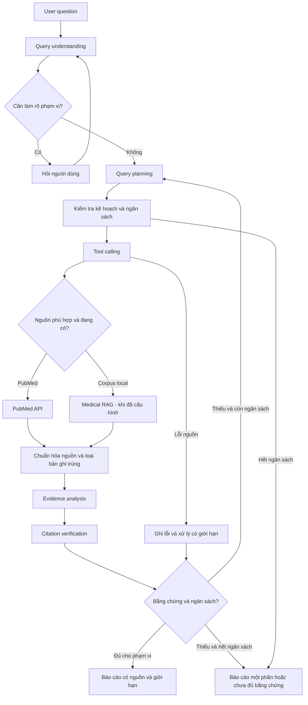

# Workflow dự kiến — Một agent nghiên cứu cho nhiều chủ đề y khoa

**Trạng thái:** Đã có vòng lặp search/fetch có giới hạn và kiểm thử model local với dữ liệu phát lại. Tra cứu online có lúc gặp trang chặn HTML của NCBI, chưa xác nhận trọn luồng online ổn định. Medical RAG và quy trình phân tích nhiều nghiên cứu vẫn là thiết kế chưa triển khai.

Mục tiêu học và các ví dụ: [project-brief.md](project-brief.md).
Bài thực hành hiện tại: [nối search và fetch bằng vòng lặp](7.md).

Xem nhanh bằng sơ đồ: [pipeline học theo 15 phần PDF](learning-pipeline.md).

## 1. Quyết định kiến trúc

Một workflow dùng chung xử lý Alzheimer, ung thư phổi, COPD và các chủ đề khác.
Model phân tích câu hỏi để tạo kế hoạch có cấu trúc, thuật ngữ và truy vấn phù hợp.
Python kiểm tra dữ liệu, thực thi tool, lưu state và cưỡng chế giới hạn.

Không tạo `if disease == ...` để chọn một agent hoặc một prompt riêng cho từng bệnh.
Các tên bệnh trong bộ tình huống là dữ liệu kiểm thử, không phải danh sách cho phép
của hệ thống. Schema, tên tool, giới hạn và policy được định nghĩa trong code.

Các khối dưới đây là các bước xử lý, không yêu cầu mỗi khối là một agent/model riêng.
Bản đầu có thể dùng một model và một bộ điều phối.

## 2. Luồng có phản hồi

Sơ đồ thể hiện nhánh cần thiết, không yêu cầu luôn gọi cả PubMed và Medical RAG.
Nếu hai lượt đọc độc lập đều cần thiết, có thể thực hiện song song sau khi đã hiểu
và đo được phiên bản tuần tự. Nguồn chưa cấu hình không được đưa vào danh sách tool.

Một pipeline đi thẳng chỉ thực thi các bước đã định. Phần agentic của thiết kế
là quyền lựa chọn truy vấn/tool và điều chỉnh bước tiếp theo từ kết quả quan sát,
trong giới hạn do code kiểm soát.

## 3. Trách nhiệm từng bước

| Bước | Model cần làm | Code/runtime cần làm | Đầu ra để kiểm tra |
|---|---|---|---|
| Query understanding | Tách chủ đề, mục tiêu, điều kiện đã nêu và phần chưa rõ | Validate schema, giữ nguyên câu hỏi và không biến giá trị thiếu thành dữ kiện | QuestionSpec |
| Query planning | Đề xuất nhóm thuật ngữ, truy vấn, nguồn và tiêu chí chọn tài liệu | Kiểm tra tool được phép, ngày, số lượng và ngân sách | SearchPlan |
| Tool calling | Yêu cầu gọi tool với tham số có cấu trúc | Gọi API/retrieval thật, timeout, parse và trả lỗi rõ | ToolResult |
| Evidence analysis | Trích xuất thông tin được nguồn hỗ trợ, đối chiếu theo câu hỏi | Gắn source ID, giữ đoạn chứng cứ, phát hiện trường thiếu | EvidenceTable và Claims |
| Citation verification | Hỗ trợ đối chiếu nhận định với đoạn nguồn | Kiểm tra định danh, nguồn đã lấy và đoạn trích; giữ kết quả đánh giá chưa chắc chắn | VerificationResults |
| Final report | Viết báo cáo theo hợp đồng đầu ra | Kiểm tra trường bắt buộc, tham chiếu và trạng thái hoàn thành | ResearchReport |

Model không tự thực thi Python/API. Nó tạo yêu cầu; code thực hiện và đưa kết quả
trở lại context. Nhật ký ghi input/output có cấu trúc và tóm tắt quyết định cần thiết
cho debug, không cần thu thập suy nghĩ nội bộ của model.

## 4. Hiểu câu hỏi mà không hardcode bệnh

QuestionSpec cần biểu diễn được các trường phù hợp:

- Câu hỏi gốc và ngôn ngữ.
- Chủ đề/bệnh, có thể nhiều hơn một khái niệm.
- Quần thể, can thiệp hoặc phơi nhiễm, đối chứng, kết cục nếu được nêu.
- Khoảng thời gian được yêu cầu, thời điểm thực hiện tìm kiếm và phần chưa rõ.
- Loại yêu cầu: tìm liên hệ, so sánh can thiệp/sàng lọc, tổng hợp kết cục hoặc loại khác.
- Các trường cần có trong bảng đầu ra.
- Điều kiện chưa được người dùng nêu hoặc chưa được xác nhận.

Không bắt buộc mọi câu hỏi phải có đủ tất cả các trường.
Với câu hỏi Alzheimer, chất lượng giấc ngủ là phơi nhiễm cần xem xét, nguy cơ mắc
Alzheimer là kết cục cần tìm; không tự suy ra độ tuổi hoặc loại nghiên cứu bắt buộc.
Với COPD, “gần đây” cần được làm rõ hoặc thay bằng một mặc định được công bố.
Với sàng lọc ung thư phổi, giữ yêu cầu nhóm nguy cơ cao nhưng không tự tạo tiêu chí
tuổi, tiền sử hoặc ngưỡng nguy cơ mà câu hỏi chưa nêu.

Ngày tìm kiếm là dữ liệu runtime. Nếu chạy ngày 27/10/2026, báo cáo phải thể hiện
thời điểm đó và không tuyên bố đã rà soát hết năm 2026. Giữ riêng khoảng năm người dùng
yêu cầu với khoảng thời gian thực sự áp dụng. PubMed có các trường ngày khác nhau;
việc lọc ngày cần được ghi rõ trong bài API.

## 5. Query planning là một giả thuyết có thể kiểm tra

Kế hoạch gồm các nhóm thuật ngữ/đồng nghĩa, truy vấn dự kiến, bộ lọc đã xác nhận,
tiêu chí liên quan và cách điều chỉnh nếu kết quả không đạt.

Không coi các thuật ngữ MeSH model đề xuất là đã được xác nhận. Khi dùng MeSH cần
đối chiếu nguồn phù hợp. Không coi mọi bộ lọc là vô hại: có thể giảm số tài liệu tìm được.

Lưu truy vấn đã gửi, thời điểm, bộ lọc, cảnh báo và thông tin query translation
khi API cung cấp. PubMed có thể biến đổi truy vấn qua Automatic Term Mapping;
cần biết hệ thống thật sự đã tìm gì.

Không tự bỏ điều kiện thời gian/quần thể của người dùng để tăng số kết quả.
Một kế hoạch có cú pháp hợp lệ chưa chứng minh truy xuất đủ hoặc đúng tài liệu.

## 6. Vai trò của hai nhánh dữ liệu

### PubMed API — nguồn đầu tiên

Tool dự kiến:

- `search_pubmed`: nhận truy vấn và bộ lọc hợp lệ, trả định danh ứng viên và thông tin tìm kiếm.
- `fetch_pubmed_records`: nhận các PMID đã chọn, trả metadata và abstract nếu có.

Một bài có trong kết quả tìm kiếm chưa có nghĩa nội dung phù hợp với câu hỏi.
Sau khi lấy bản ghi mới kiểm tra mức liên quan và thông tin có thể trích xuất.

### Medical RAG — phần mở rộng

Tool dự kiến `search_medical_corpus` chỉ được bật khi có corpus và index đã kiểm tra.
Nguồn có thể là VIBioMIR hoặc tài liệu khác được phép sử dụng.

Mỗi kết quả cần source ID, đoạn nội dung, vị trí/ID chunk và phiên bản tài liệu.
Tài liệu phân loại hay hướng dẫn và bài nghiên cứu có vai trò khác nhau;
không lấy một nguồn phân loại bệnh làm bằng chứng chung về hiệu quả điều trị.

Khi cùng bài xuất hiện ở cả hai nguồn, chuẩn hóa theo PMID/DOI khi có để tránh
đếm trùng. Không ép tài liệu không có PMID/DOI phải có định danh đó; dùng định danh
nguồn local và xuất xứ thực tế.

## 7. Bảng bằng chứng và báo cáo

Các cột tùy câu hỏi, tối thiểu có:

| Trường | Quy tắc |
|---|---|
| source_id, tiêu đề, năm, PMID/DOI nếu có | Lấy từ bản ghi thực tế, không tạo mã hoặc năm giả |
| Quần thể | Ghi đặc điểm được tài liệu mô tả; thiếu thì đánh dấu |
| Thiết kế/phương pháp | Có nguồn hỗ trợ; chưa xác định được thì ghi chưa rõ |
| Can thiệp/phơi nhiễm, đối chứng | Chỉ ghi khi áp dụng và có thông tin |
| Kết cục/thước đo | Giữ tên và ngữ cảnh từ nguồn; không gộp những thước đo khác nhau thành một số |
| Phát hiện/số liệu | Gắn đoạn chứng cứ và điều kiện áp dụng |
| Phần đã đọc | Metadata, abstract hay full-text thực sự được truy cập |
| Giới hạn | Phân biệt hạn chế do tác giả nêu với giới hạn của việc tra cứu |

Nếu chỉ có abstract, không điền chi tiết phương pháp hoặc số liệu không xuất hiện
trong abstract. PubMed không đồng nghĩa đã có toàn văn.

Tách phần bằng chứng từ nghiên cứu gốc và từ tổng quan. Trong bài đầu, không tự
tính hiệu quả gộp hay thực hiện meta-analysis, không tự chấm độ chắc chắn bằng chứng
như một đánh giá chuyên môn đã được kiểm định.

Nhận xét nhất quán/mâu thuẫn phải gắn với kết cục, quần thể và phương pháp có thể
đối chiếu. Chỉ khác hướng kết quả chưa đủ để tự khẳng định hai nghiên cứu mâu thuẫn.
Không chuyển mô tả mối liên hệ thành kết luận nhân quả, hoặc chỉ dựa vào nhãn thiết kế
nghiên cứu để tuyên bố đã chứng minh nhân quả.

Báo cáo gồm: câu hỏi/phạm vi, nhật ký tìm kiếm tóm tắt, bảng nghiên cứu, tổng hợp
có trích dẫn, phần nhất quán/khác biệt, thông tin chưa xác minh và giới hạn.

## 8. Citation verification có nhiều phép kiểm

| Phép kiểm | Có thể kiểm tra gì? | Chưa chứng minh điều gì? |
|---|---|---|
| Định danh | PMID/DOI và metadata khớp bản ghi đã truy xuất | Nhận định đúng |
| Đoạn chứng cứ | Đoạn trích xuất hiện trong nội dung thực sự đã lấy | Đoạn đó đủ hỗ trợ nhận định |
| Nhận định ↔ bằng chứng | Đối chiếu phạm vi và nội dung; đánh dấu supported/partial/unsupported/uncertain | Chất lượng khoa học tổng thể hoặc sự thật tuyệt đối |
| Diễn giải | Kiểm tra có vượt phạm vi, biến liên hệ thành nhân quả hay bỏ điều kiện không | Một đánh giá chuyên môn toàn diện |

Hai phép kiểm đầu có thể dùng code để đối chiếu. Phép kiểm ngữ nghĩa cần rubric,
đánh giá mẫu của con người và đo lỗi của model chấm nếu dùng.
Không đặt một cờ `verified=true` chỉ vì URL mở được hoặc model tự nói đã xác minh.

Nhận định không được hỗ trợ cần được sửa, bỏ hoặc trình bày là chưa đủ bằng chứng.
Trạng thái uncertain phải được giữ rõ thay vì tự chuyển thành supported.

## 9. State, ngân sách và cách kết thúc

State dự kiến giữ: câu hỏi, QuestionSpec, kế hoạch, truy vấn đã chạy, bản ghi nguồn,
bảng bằng chứng, nhận định, kết quả kiểm tra, lỗi và ngân sách còn lại.

Để học trước, có thể bắt đầu với tối đa 2 vòng tìm kiếm và 5 bản ghi được lấy nội dung
cho mỗi lượt chạy; đây là tham số thực nghiệm, chưa được đo là tối ưu.
Số model call, thời gian và context cũng phải có giới hạn theo máy/model đang chạy.
Không nhồi tất cả abstract vào context 2048 token của bài 1; phần phân tích báo cáo
cần thiết kế chọn lọc/chia lượt và đo token riêng.

Điều kiện dừng:

- Đạt hợp đồng báo cáo trong phạm vi đã định và các nhận định quan trọng có bằng chứng hỗ trợ.
- Cần người dùng làm rõ thông tin ảnh hưởng lớn đến việc tìm kiếm.
- Không có thêm thông tin sau khi điều chỉnh hợp lệ, hoặc đã hết ngân sách.
- Nguồn lỗi khiến không thể tiếp tục; báo lỗi hoặc xuất phần đã có với giới hạn rõ.

“Không có kết quả phù hợp trong lượt tìm này” khác “API không truy cập được”.
Không dùng kết quả của vài bản ghi để tuyên bố đã bao phủ toàn bộ y văn.

## 10. Thứ tự thực hành

1. Hoàn thành bài gọi model API local và đọc được một response thật.
2. Gọi PubMed trực tiếp, chưa để model điều khiển; hiểu input/output và lỗi của tool.
3. Tạo QuestionSpec cho ba câu hỏi, so với yêu cầu; chưa cần sinh báo cáo.
4. Sinh SearchPlan và cho người học kiểm tra truy vấn trước khi thực thi.
5. Kết nối tool calling, sau đó thêm vòng tìm bổ sung có giới hạn.
6. Trích xuất bảng bằng chứng, kiểm tra trích dẫn và tạo báo cáo.
7. Chạy cả ba tình huống, thêm ca lỗi, rồi mới thử nhánh Medical RAG.

Đây là kiến trúc đích để định hướng học; không triển khai toàn bộ trong một lượt.

## 11. Nguồn tham khảo kỹ thuật

- [PubMed User Guide](https://pubmed.ncbi.nlm.nih.gov/help/): cú pháp tìm, biến đổi truy vấn, bộ lọc và phạm vi abstract/full-text.
- [NCBI APIs](https://www.ncbi.nlm.nih.gov/home/develop/api/): API tìm kiếm và truy xuất dữ liệu.

Các quy tắc workflow và ngân sách trong tài liệu là quyết định thiết kế cho dự án học,
không phải kết quả kiểm chứng tính hiệu quả của agent hoặc kết luận y khoa.
